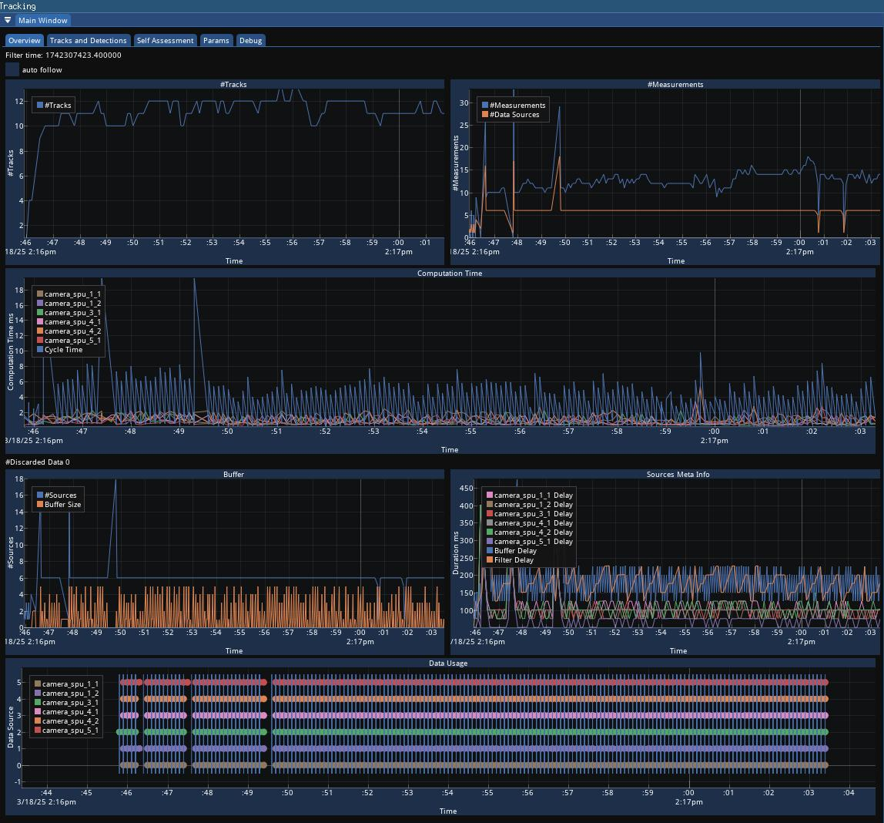
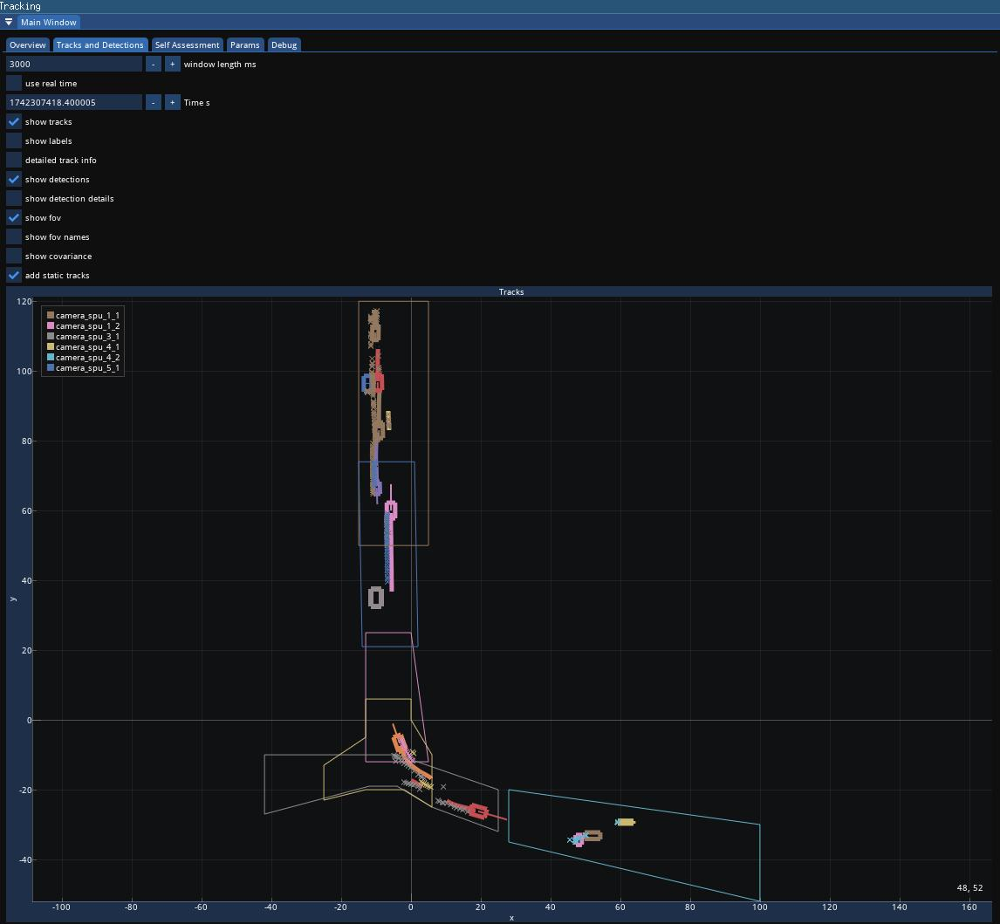
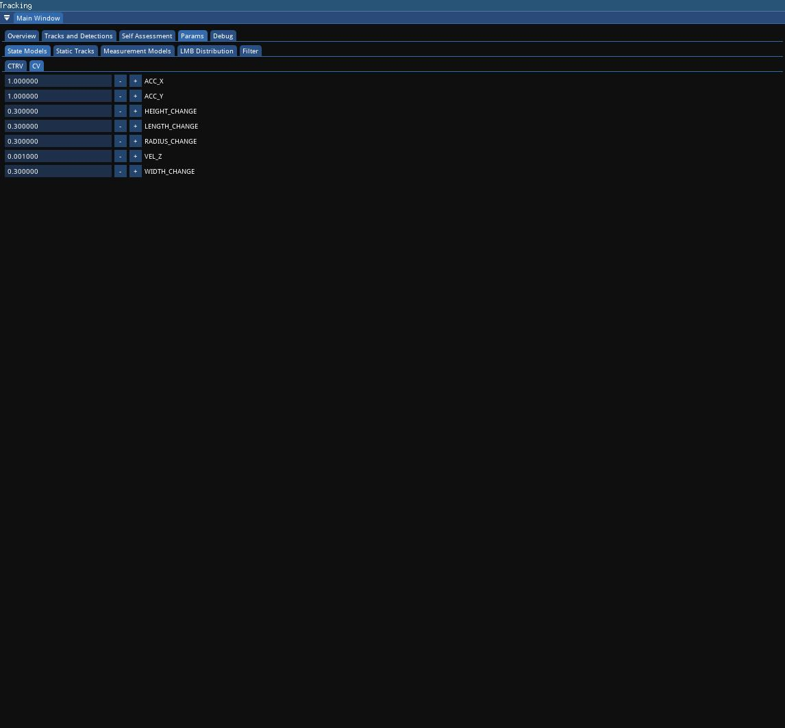
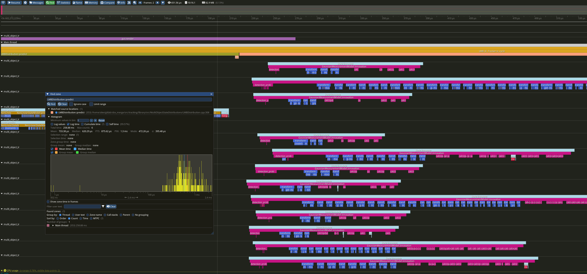
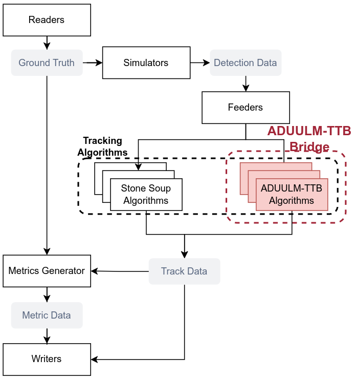
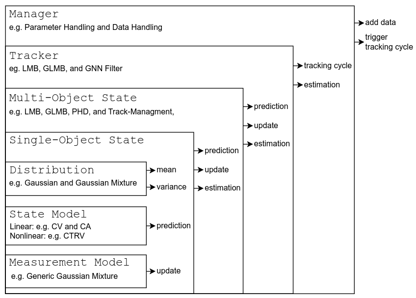

# ADUULM-TTB: A Scalable, Generic, and Efficient Multi-Sensor Multi-Object Tracking Toolbox

This repository contains the code of the ADUULM-TTB (Autonomous Driving at Ulm University - Tracking ToolBox).

If you use this toolbox, please cite [ADUULM-TTB: A Scalable, Generic, and Efficient Multi-Sensor Multi-Object Tracking Toolbox](https://ieeexplore.ieee.org/document/11259402) as
```
@INPROCEEDINGS{ttb,
  author={Scheible, Alexander and Hermann, Charlotte and Griebel, Thomas and Buchholz, Michael and Dietmayer, Klaus},
  booktitle={2025 IEEE International Conference on Multisensor Fusion and Integration for Intelligent Systems (MFI)}, 
  title={ADUULM-TTB: A Scalable, Generic, and Efficient Multi-Sensor Multi-Object Tracking Toolbox}, 
  year={2025},
  volume={},
  number={},
  pages={1-8},
  keywords={Surveillance;Scalability;Benchmark testing;Libraries;Usability;Intelligent systems;Robots},
  doi={10.1109/MFI67357.2025.11259402}
}

```
You can also find a open-access version of the paper at the open-access repository of Ulm University [here](https://oparu.uni-ulm.de/items/ba8132f9-bcdf-4edd-8ee1-45eb8b46bd67).


The toolbox is the basis of the following publications:
* [Track Classification for Random Finite Set Based Multi-Sensor Multi-Object Tracking](https://doi.org/10.1109/SDF-MFI59545.2023.10361438)
* [Self-Monitored Clutter Rate Estimation for the Labeled Multi-Bernoulli Filter](https://doi.org/10.23919/FUSION59988.2024.10706463)
* [An Efficient Implementation of the Fast Product Multi-Sensor Labeled Multi-Bernoulli Filter](https://doi.org/10.1109/MFI62651.2024.10705774)
* [Self-Monitored Detection Probability Estimation for the Labeled Multi-Bernoulli Filter](https://ieeexplore.ieee.org/document/10920041)
* [Online Monitoring for Multi-Object Measurement Model Parameters](https://ieeexplore.ieee.org/document/11123951)
* Differentiable Labeled Multi-Bernoulli Filtering for Unsupervised Filter Model Learning in Multi-Object Tracking

Within the toolbox, the filters of the following publications are implemented:
* [Multi-Sensor Multi-Object Tracking With the Generalized Labeled Multi-Bernoulli Filter](https://ieeexplore.ieee.org/document/8861414)
* [Distributed Implementation of the Centralized Generalized Labeled Multi-Bernoulli Filter](https://ieeexplore.ieee.org/document/9524466)
* [Notes on the Product Multi-Sensor Generalized Labeled Multi-Bernoulli Filter and its Implementation](https://ieeexplore.ieee.org/document/9841275)
* [The Fast Product Multi-Sensor Labeled Multi-Bernoulli Filter](https://ieeexplore.ieee.org/document/10224189)
* [An Efficient Implementation of the Fast Product Multi-Sensor Labeled Multi-Bernoulli Filter](https://ieeexplore.ieee.org/document/10705774)
* [The Labeled Multi-Bernoulli Filter](https://ieeexplore.ieee.org/document/6814305)
* [A fast implementation of the Labeled Multi-Bernoulli filter using gibbs sampling](https://ieeexplore.ieee.org/document/7995809)
* [A Fast Labeled Multi-Bernoulli Filter Using Belief Propagation](https://ieeexplore.ieee.org/document/8836103)
* [Labeled random finite sets and multi-object conjugate priors](https://ieeexplore.ieee.org/document/6507656)
* [An Efficient Implementation of the Generalized Labeled Multi-Bernoulli Filter](https://ieeexplore.ieee.org/document/7790845)
* [A Solution for Large-Scale Multi-Object Tracking](https://ieeexplore.ieee.org/document/9063553)
* [Poisson Multi-Bernoulli Mixture Filter: Direct Derivation and Implementation](https://ieeexplore.ieee.org/document/8289337)
* [Efficient approximations of the multi-sensor labelled multi-Bernoulli filter](https://www.sciencedirect.com/science/article/pii/S0165168422001736)

Furthermore, the following filters are implemented:
* [GNN](include/tracking_lib/Trackers/GNN_Tracker.h): Multi-instances Kalman Filter like mulit-object tracker with global-nearest neighbor association.
* [NO](include/tracking_lib/Trackers/NO_Tracker.h): Just forwards all measurements as tracks
* [Id-Tracker](include/tracking_lib/Trackers/Id_Tracker.h): For tracking of measurements with unique ids, e.g., for aruco markers

The top-level interface of the library is Python-binded with [nanobind](https://github.com/wjakob/nanobind).
All bindings are specified in [PythonBindings.cpp](src/Bindings/PythonBindings.cpp).
See this [tracking-scenario](python/tracking_simulator/run_simulation.py) as an example that uses a small handcrafted simulator.

We depend on several great projects.
Thanks to
* [figcone](https://github.com/kamchatka-volcano/figcone): Awesome library for handling configuration files. Check this out.
* [Eigen3](https://eigen.tuxfamily.org/index.php?title=Main_Page): Powers all our linear algebra computations
* [boost](https://www.boost.org/): Collection of various C++ libraries. Notably is the [Boost Multi-index Containers Library](https://www.boost.org/doc/libs/latest/libs/multi_index/doc/index.html) that lets you access a common database using different keys.
* [imgui](https://github.com/ocornut/imgui) and [implot](https://github.com/epezent/implot): Hassle-free gui libraries for C++.
* [tracy](https://github.com/wolfpld/tracy): Runtime measurement on steroids
* [nanobind](https://github.com/wjakob/nanobind): Python bindings
* [hpx](https://github.com/TheHPXProject/hpx): Powers our multithreaded executions. Great at handling many small parallel tasks. Bit of a pain point in combination with python bindings and imgui.
* [type_safe](https://github.com/foonathan/type_safe): Strong types. Used for all kinds of different IDs ...
* and many more!


# Installation with the provided Docker Container

For installation, we provide a kind-of minimal Dockerfile:

0. Install [Docker](https://docs.docker.com/engine/install/)

1. Set up your workspace, in the following referred as {WORKSPACE}, and download aduulm_ttb
    ```
    cd {WORKSPACE}
    git clone https://github.com/uulm-mrm/aduulm_ttb.git
    cd aduulm_ttb
    git submodule update --init --recursive
    ```

2. Build the docker image:
    ```
    cd {WORKSPACE}/aduulm_ttb/docker
    docker build . --tag tracking:0
    ```

3. Start the docker:
    ```
    docker run --rm -i -t -v $(eval echo ~$USER):$(eval echo ~$USER) -v /etc/group:/etc/group:ro -v /etc/passwd:/etc/passwd:ro -v /tmp/.X11-unix:/tmp/.X11-unix:rw -v /tmp:/tmp:rw -v /etc/shadow:/etc/shadow:ro --user $(id -u):$(id -g) --ipc=host -e DOCKER_MACHINE_NAME="tracking" -e LD_LIBRARY_PATH=${LD_LIBRARY_PATH}:/usr/local/lib -e DISPLAY=$(echo $DISPLAY) -e MPLBACKEND=agg --privileged --group-add sudo --add-host=localhost:$(ip -4 addr show scope global | grep -m1 inet | awk "{print \$2}" | cut -d / -f 1) --add-host=$(cat /etc/hostname):$(ip -4 addr show scope global | grep -m1 inet | awk "{print \$2}" | cut -d / -f 1) --group-add dialout --ipc=host --device /dev/dri --user 1000:1000 -v ${HOME}/.local/lib/python3.12 tracking:0 $(echo bash)    
   ```

4. Source ros (this is needed for colcon):
    ```
    source /opt/ros/lyrical/setup.$(ps -o fname --no-headers $$)
    ```

5. Copy the contents of /workspace to your {WORKSPACE}. This includes all necessary dependencies to build the library.
    ```
    cp -r /workspace/* {WORKSPACE}
    ```

   Now your {WORKSPACE} should look like this.
    ```
    {WORKSPACE}
      - aduulm_ttb (https://github.com/uulm-mrm/aduulm_ttb)
      - aduulm_logger (https://github.com/uulm-mrm/aduulm_logger.git)
      - aduulm_cmake_tools (https://github.com/uulm-mrm/aduulm_cmake_tools.git)
      - minimal_latency_buffer (https://github.com/uulm-mrm/minimal_latency_in_sequence_buffer)
      - eslimpp (https://github.com/uulm-mrm/eslimpp.git)
    ```

6. Build the ttb. Beware, this is a rather large build. As long as the build finishes, you can ignore any build warnings that may show up. 
    ``` 
    cd {WORKSPACE}
   taskset -c 0-10 colcon build --packages-up-to tracking_lib
    ```

7. Source the installed packages.
    ``` 
    source install/setup.$(ps -o fname --no-headers $$)
    ```

8. Test your installation with an example filter configuration of the tutorials folder.
    ```
    cd {WORKSPACE}
    LD_PRELOAD=/lib/x86_64-linux-gnu/libjemalloc.so.2 run_simulation.py --tracking_config_path aduulm_ttb/tutorials/lmb_ic_lbp.yaml --wait
    ```
   The preload should only be necessary when using the python bindings, if you compile a C++ executable, it should work without the preload.
   In the same folder, there are also configurations for other filters.

Enjoy.
If you encounter any problems, it is generally a good idea to build a debug version.
The whole library is cluttered with assertions that check for almost any conditions that can fail.

# Features

## Configuration

The behaiviour is entirely controlled by a single configuration yaml file.
Example for these are found in the [tutorials](tutorials) folder.
To read in this yaml, the library [figcone](https://github.com/kamchatka-volcano/figcone) is used.
The corresponding C++ parameter data structure is defined in [Params.h](include/tracking_lib/TTBTypes/Params.h).
The yaml file must exactly match the definition there, otherwise a hard error is raised.
If you can find a invalid configuration which does not result in a meaningful error message or just crashes (in a debug build), please report the problem and configuration.

## GUI

The toolbox includes a GUI for vizualisation.
To enable the gui, set `show_gui: true` in the config file.
When using the gui in combination with python, it is recommended to wait for the gui to close.
In `run_simulation.py`, there is the `--wait` flag for this.
The GUI is written with imgui and is easily extendable.
The entire gui code is contained in [Visualization.cpp](src/TTBManager/Visualization.cpp).
Here are some screenshot demonstrating the capabilities.



(Overview over the number of tracks, number of measurements, computation time per cycle, number of buffered data, data
delay, and data acquisition time vs cycle trigger time)



(Overview over tracks and measurements of the current or previous time, FOV of sensors, and more)



(View and dynamically adapt parameters during live operation)

## Tracy

[Tracy](https://github.com/wolfpld/tracy) is a great frame profiler that measures the runtime of annotated functions.
To enable tracy, you must build the toolbox with TRACY_ENABLED, e.g., with
```
colcon build --packages-up-to tracking_lib --cmake-args -DTRACY_ENABLE=ON
```
The visualization server is pre-built in the provided docker and can be launched with `tracy-profiler`.
To use tracy, launch the profiler and connect to a running aduulm_ttb application.



(Tracy profiler)

## Stone Soup bridge

The toolbox includes a [stonesoup_bridge](python/stonesoup_bridge/bridge.py) to the tracking framework [stonesoup](https://github.com/dstl/Stone-Soup).
It translates from stonesoup data types to aduulm_ttb types and back.


You find code that uses this bridge in [stone soup tutorials](python/stonesoup_bridge/tutorials).

# Toolbox Structure
The toolbox uses a hierarchical structure.



As user, you typically interact with the [TTBManager](include/tracking_lib/TTBManager/TTBManager.h).
This object provide the high-level interface and methods to add measurements from data sources and trigger a tracking cycle.

As principal design guideline, a component should only interact with its direct subcomponents.
For example, the [Tracker](include/tracking_lib/Trackers/Tracker.h) should only interact with a `M̀ulti-Object State`,e.g., a [LMBDistribution](include/tracking_lib/MultiObjectStateDistributions/LMBDistribution.h) and never with an individual [State](include/tracking_lib/States/State.h).
This ensures a more or less strict, loose coupling between elements which should be exchangeable.
For example, `Tracker` level code should abstract the concrete Distribution representation, e.g., it should work the same for a Gaussian or Particle distribution.
This ensures that all combinations of useful configurations are valid and result in a working filter.

To gain a deeper understanding, I suggest to start with the [TTBManager](include/tracking_lib/TTBManager/TTBManager.h) and the corresponding [Python bindings](src/Bindings/PythonBindings.cpp).

### Distribution

A distribution describes a stochastic distribution, e.g., a Gaussian distribution.
The interface of a distribution is defined as concept in [Concepts.h](include/tracking_lib/TTBTypes/Concepts.h) with small wrapper in [Distribution.h](include/tracking_lib/Distributions/Distribution.h).

Distribution.h 
Note that this interface is NOT general enough to encode all kind of (representations of) distributions.
For example, if you want to implement a particle representation of a distribution for a Particle Filter you may have to
adapt the interface.
Currently, only a (multivariate) Gaussian and mixture distribution of arbitrary components are implemented.
Note, that a distribution on its own has no semantic connection to physical entities like position or velocity.

The distributions have no dependencies to any other part of the toolbox.

### State

The [state](include/tracking_lib/States/State.h) (of an object that you want to track) encodes information about a
single! object.
This includes the kinematic information (position, pose, velocity, acceleration, ....), classification, but also meta
information like time of appearance, number of updates, etc.
A state can be predicted to a certain time and updated by
a measurement. The measurements and informations about the sensor are stored in a [data source container](include/tracking_lib/DataContainer/DataSourceContainer.h).

The kinematic information is encoded by a distribution.
To do so, the elements of the distribution are interpreted according to
some [state model](include/tracking_lib/StateModels) with certain components.
For example, the [Constant Position (CP)](include/tracking_lib/StateModels/CPStateModel.h) state model describes an
object throgh its position in X, Y, and Z coordinates.
The [Constant Velocity (CV)](include/tracking_lib/StateModels/CVStateModel.h) also includes the velocity in X, Y, and Z
coordinates.

Multi-Model states are supported.
Then, the kinematic state is given by different state models with different distributions.

### State Model

The [state models](include/tracking_lib/StateModels) define how to predict the kinematic information of a state.
Also, they specify how interpret the [components](include/tracking_lib/TTBTypes/Components.h) of the distribution, i.e.,
make
the connection from, e.g., the third element of the mean of the Gaussian distribution and the velocity in y-axis
direction.
The following state models are implemented

* [CP](include/tracking_lib/StateModels/CPStateModel.h): Constant position
* [CTP](include/tracking_lib/StateModels/CTP.h): Constant position and yaw
* [CV](include/tracking_lib/StateModels/CVStateModel.h): Constant velocity
* [CA](include/tracking_lib/StateModels/CAStateModel.h): Constant acceleration
* [CTRV](include/tracking_lib/StateModels/CTRVStateModel.h): Constant turn rate and velocity
* [CTRA](include/tracking_lib/StateModels/CTRAStateModel.h): Constant turn rate and acceleration
* [ISCATR](include/tracking_lib/StateModels/ISCATRStateModel.h): Independent split constant turn and turn rate ([Toward Intelligent Automated Driving Functionalities for Multipurpose Vehicles in UNICARagil](https://ieeexplore.ieee.org/document/11643228))

Every state model supports also the extension of its state components by length, width, and height.

### Measurement Model

The [measurement models](include/tracking_lib/MeasurementModels) define how to update a state with a measurement.
Currently, only a generic measurement model based on Gaussian mixtures (both state and measurement must be Gaussian (
mixtures)) is implemented.
For some reasons, the update is implemented as member function of a class, in future releases this may be replaced by a better structure.
It relies on trivial state to measurement space transformations, e.g., the measurement components is a subset of the
state components or given by an unambiguous transformation like cartesian to polar.
These transformations are defined in [Transformation.h](include/tracking_lib/Transformations/Transformation.h).
It is able to handle measurements with arbitrary components.
Based on the components of the state and of the measurement, the update is either peformed by a linear Kalman filter
update in Joseph form (linear case), or based on the cross-covariance between the state and measurement calculated by an
unscented transformation (non-linear case).
Additionally, the measurement model define properties needed for the multi-object tracking case like the clutter
intensity of a measurement and the detection probability.
For ease of interpretation and implementation, these properties are defined point-wise.

### Transformation

On multiple places, it is required to transform a vector or even a distribution over some components to some other
components (e.g., during the state update step).
There is a high change that this is defined
in [Transformation.h](include/tracking_lib/Transformations/Transformation.h).

### Multi-Object State Distributions

Here, set-valued distributions over a collection of states are defined.
Currently, the following distributions are implemented:

* [Generalized Labeled Multi-Bernoulli (GLMB)](include/tracking_lib/MultiObjectStateDistributions/GLMBDistribution.h)
* [Labeled Multi-Bernoulli (LMB)](include/tracking_lib/MultiObjectStateDistributions/LMBDistribution.h)
* [Multi-Bernoulli Mixture (MBM)](include/tracking_lib/MultiObjectStateDistributions/MBMDistribution.h)
* [Poisson Multi-Bernoulli Mixture (PMBM)](include/tracking_lib/MultiObjectStateDistributions/PMBMDistribution.h)
* [Poisson Point Process (PP) / Probability Hypothesis Density (PHD)](include/tracking_lib/MultiObjectStateDistributions/PoissonPointProcess.h)

Since multi-object distributions are defined for states, they directly support prediction and update.


### Trackers

The [interface](include/tracking_lib/Trackers/Tracker.h) of a tracker is kept very simple.
It basically requires only the definition of a cycle and an estimation method. 
For generic iterator-corrector/sequential multi-sensor filters, there is also this template [ICTracker.h](include/tracking_lib/Trackers/ICTracker.h).
For generic multi-sensor/paralell sensor update filters, there is this template: [MSTracker.h](include/tracking_lib/Trackers/MSTracker.h) 
These allow a common implementation of many filter.
For a complete overview over the implemented Trackers, see [Tracker.h](include/tracking_lib/Trackers/Tracker.h).
Since many filters use a common implementation, the most filter variants are defined through a config file.
Example of useful combinations are listed in [tutorials](tutorials).